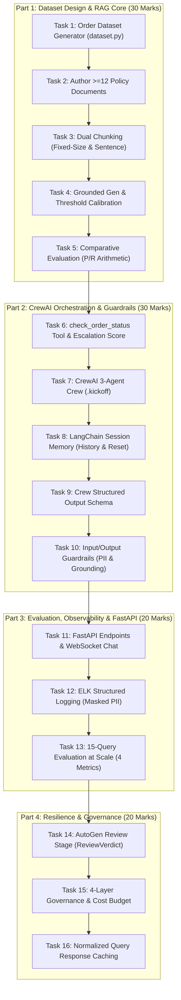

# Capstone Implementation Plan: Nykaa Domain Support Agent

**Project:** Nykaa Domain Support Agent (CrewAI, AutoGen, LangChain, ChromaDB)<br>
**Academic Context:** IIT Roorkee Agentic AI Capstone Project<br>
**Authoritative Specification:** `docs/IITR_Final_Capstone_Brief.pdf` (Treat as 100% authoritative source of truth)<br>
**Operating Environment:** Windows 10/11 (AMD64) | Python 3.12.10 | Fully Offline / `MOCK_LLM` Capable<br>
**Current Status:** All Milestones Complete (Milestones 1–6 Verified)

---

## 1. Project Overview & Deliverables Architecture

The objective of this capstone is to engineer an enterprise-grade, deterministic customer support system for **Nykaa (E-commerce & Retail)**. The system answers customer policy inquiries grounded strictly in an authored knowledge base, inspects order status and computes recency/delay escalation metrics, remembers multi-turn conversational context, guards against fixed-format PII and adversarial prompt injection, passes draft answers through an independent AutoGen multi-agent review team, operates under an explicit multi-layer AI governance framework, provides an ELK JSON-Lines structured audit trail with disk-side PII masking, and serves real-time multi-turn interactions through FastAPI and WebSocket endpoints.

### Key Tenets & Authoritative Rules:
1. **Single Deliverable:** One public GitHub repository containing all source code, `dataset.py`, $\ge 12$ policy documents, tests, and execution transcripts.
2. **Zero API Key & Offline Guarantee:** Embeddings (`all-MiniLM-L6-v2`) and ChromaDB run 100% locally. Language model calls (grounded generation, evaluation judge, CrewAI crew, and AutoGen review team) default to a deterministic `MOCK_LLM` requiring zero API keys and zero network calls, validated by an active in-process socket connection interceptor.
3. **Strict Schema Preservation:** All required field names, category names, status values, thresholds, and deliverables from `docs/IITR_Final_Capstone_Brief.pdf` are preserved exactly.

---

## 2. Verified Package Versions & Official API Compatibility Matrix

The Python environment has been verified with `pip check` (0 broken requirements) and pinned in `requirements-lock.txt`.

| Library | Installed Version | Relevant APIs Verified | Key Compatibility Details |
| :--- | :--- | :--- | :--- |
| **Python** | `3.12.10` | Standard library, `asyncio`, `re`, `json` | Required for binary wheel compatibility with PyTorch & ChromaDB on Windows. |
| **CrewAI** | `1.15.30` | `Agent`, `Task`, `Crew`, `LLM`, `BaseLLM`, `tool` | Subclasses `BaseLLM.call()`, ReAct pattern, `OTEL_SDK_DISABLED="true"`. |
| **AutoGen AgentChat** | `0.7.5` | `AssistantAgent`, `RoundRobinGroupChat`, `MaxMessageTermination` | Modern v0.4+ async architecture with `output_content_type` and `StructuredMessage`. |
| **AutoGen Core** | `0.7.5` | `ChatCompletionClient`, `CreateResult`, `RequestUsage` | Custom mock client implementing `create()`, `create_stream()`, `model_info`. |
| **LangChain Core** | `1.7.0` | `BaseChatModel`, `AIMessage`, `HumanMessage`, `SystemMessage` | Custom `BaseChatModel._generate()` for LCEL chains. |
| **LangChain** | `1.4.7` | `InMemoryChatMessageHistory`, `RunnableWithMessageHistory` | Session-based memory across conversational turns. |
| **ChromaDB** | `1.5.9` | `EphemeralClient`, `PersistentClient`, `Collection` | Supports pre-computed embeddings and local SentenceTransformers (`collection.upsert()`). |
| **Sentence-Transformers** | `6.2.0` | `SentenceTransformer('all-MiniLM-L6-v2')` | Local weights cached in `~/.cache/huggingface/hub`; offline compatible. |
| **Pydantic** | `2.12.5` | `BaseModel`, `Field`, `model_validate`, `model_dump_json` | Strict schema validation for datasets, tool outputs, and evaluation models. |
| **FastAPI** | `0.162.0` | `FastAPI`, `APIRouter`, `WebSocket`, `WebSocketDisconnect` | Async REST routes (`/ask`, `/add-document`) and resilient WebSocket chat. |
| **Uvicorn** | `0.54.0` | `uvicorn.run()` | ASGI server with reload and event loop management. |

---

## 3. Four-Part Implementation Plan & Individual Task Breakdown

The plan strictly adheres to the 4 parts and 16 tasks defined in the capstone brief.



---

### Part 1 — Dataset Design & RAG Core (30 Marks)

#### Task 1: Design and Validate Your Own Order Dataset
- **Status:** **Verified & Complete** (Implemented & Tested)
- **Authoritative Requirements:**
  - Seeded, deterministic Python generator delivered at root as `dataset.py` producing an `ORDERS` list of $\ge 40$ order records (generates 50 records).
  - Every required category represented at least once ($\ge 3$ records each): `Apparel` (12), `Electronics` (10), `Home` (10), `Footwear` (8), `Beauty` (10).
  - Every required status represented at least once ($\ge 1$ record each): `Placed` (7), `Shipped` (13), `Delivered` (17), `Returned` (5), `Refunded` (8).
  - Required fields on every record:
    - `record_id`: str (`NYK-10001` to `NYK-10050`)
    - `category`: str
    - `status`: str
    - `order_value_inr`: int (₹445 to ₹4,899, with 1-sentence retail price reasoning)
    - `days_since_created`: int ($0 \le \text{days\_since\_created} \le 30$)
    - `delayed_shipment`: bool (exactly 20.0%, 10/50, strictly within the required 10%–30% band)
  - Direct script execution (`python dataset.py`) prints counts per category, counts per status, delayed shipment percentage, and price range reasoning.
- **Implementation Files:** [`dataset.py`](file:///d:/MyCodingFiles/VSCode/IIT_Roorkee/Capstone_Project/nykaa-support-agent/dataset.py), [`nykaa_support/dataset.py`](file:///d:/MyCodingFiles/VSCode/IIT_Roorkee/Capstone_Project/nykaa-support-agent/nykaa_support/dataset.py)
- **Tests:** `tests/test_milestone1_dataset.py::test_root_dataset_deliverable_and_orders`, `test_dataset_required_schema_fields`, `test_category_coverage`, `test_status_coverage`, `test_delayed_shipment_rate`, `test_days_since_created_range`
- **Distinction:** Strict requirement is 6 fields; preserved domain fields (`customer_name`, `carrier`, `tracking_number`) are additive extensions.

#### Task 2: Write Your Knowledge Base
- **Status:** **Verified & Complete** (Implemented & Tested)
- **Authoritative Requirements:**
  - Author $\ge 12$ distinct documents (2–5 sentences each, written in own words, covering every required topic):
    1. `01_return_window_by_category.md` (4 sentences)
    2. `02_cod_refund_timelines.md` (4 sentences)
    3. `03_delivery_slas.md` (4 sentences)
    4. `04_reverse_pickup_eligibility.md` (4 sentences)
    5. `05_warranty_terms_by_category.md` (5 sentences)
    6. `06_order_cancellation_policy.md` (4 sentences)
    7. `07_loyalty_points_redemption_policy.md` (4 sentences)
    8. `08_payment_failure_retry_policy.md` (4 sentences)
    9. `09_size_exchange_policy.md` (4 sentences)
    10. `10_damaged_item_claim_process.md` (4 sentences)
    11. `11_international_shipping_restrictions.md` (4 sentences)
    12. `12_customer_support_escalation_matrix.md` (4 sentences)
  - Fictional, internally consistent policies with zero real customer data.
- **Implementation Files:** [`data/policies/*.md`](file:///d:/MyCodingFiles/VSCode/IIT_Roorkee/Capstone_Project/nykaa-support-agent/data/policies/) (12 distinct files)
- **Tests:** `tests/test_milestone1_dataset.py::test_all_12_distinct_knowledge_base_documents` (validates document count $\ge 12$, sentence counts $\in [2, 5]$, and keyword concepts).

#### Task 3: Implement and Index Two Chunking Strategies
- **Status:** **Verified & Complete** (Implemented & Tested)
- **Authoritative Requirements:**
  - Chunk documents BOTH as **fixed-size-with-overlap** (300 characters, 60 overlap) AND as **sentence-based chunks**.
  - Embed every chunk in both sets with local `SentenceTransformer('all-MiniLM-L6-v2', local_files_only=True)`.
  - Index each strategy into its OWN separate ChromaDB collection (`nykaa_policies_fixed_overlap` and `nykaa_policies_sentence_based`) using `collection.upsert()`.
- **Implementation Files:** [`nykaa_support/rag/chunking.py`](file:///d:/MyCodingFiles/VSCode/IIT_Roorkee/Capstone_Project/nykaa-support-agent/nykaa_support/rag/chunking.py), [`nykaa_support/rag/store.py`](file:///d:/MyCodingFiles/VSCode/IIT_Roorkee/Capstone_Project/nykaa-support-agent/nykaa_support/rag/store.py)
- **Tests:** `tests/test_milestone2_task3_chunking.py` (verifies chunk sizes, overlap, metadata, separation, and idempotent upsert).

#### Task 4: Implement Grounded Generation & Empirical Threshold Calibration
- **Status:** **Verified & Complete** (Implemented & Tested)
- **Authoritative Requirements:**
  - Retrieve top-k chunks from either collection and generate answers using ONLY retrieved context.
  - Empirically calibrate the "I don't know" threshold: measured top-1 cosine similarity for 5 in-scope queries ($[0.5006, 0.7786]$, mean $0.6256$) and 3 deliberately out-of-scope queries ($[0.0820, 0.1288]$, mean $0.1021$).
  - Selected threshold: **`0.35`** (safely in the midpoint gap between clusters).
  - State measured values and chosen threshold in `README.md`.
  - Demonstrated on $\ge 5$ in-scope queries plus 3 out-of-scope queries triggering the fallback ("I don't know...").
- **Implementation Files:** [`nykaa_support/rag/generator.py`](file:///d:/MyCodingFiles/VSCode/IIT_Roorkee/Capstone_Project/nykaa-support-agent/nykaa_support/rag/generator.py), [`nykaa_support/rag/calibrate.py`](file:///d:/MyCodingFiles/VSCode/IIT_Roorkee/Capstone_Project/nykaa-support-agent/nykaa_support/rag/calibrate.py)
- **Tests:** `tests/test_milestone2_rag.py::test_task4_grounded_generation_in_scope`, `test_task4_fallback_trigger_on_out_of_scope`, `test_task4_threshold_boundary_cases`.

#### Task 5: Evaluate and Compare Both Chunking Strategies
- **Status:** **Verified & Complete** (Implemented & Tested)
- **Authoritative Requirements:**
  - For the same 5 queries from Task 4, compute precision and recall at the document level (map chunks back to parent documents and deduplicate before scoring) separately for each of the two collections.
  - Shows per-query arithmetic:
    - Fixed-Size Overlap: Mean Precision = **46.67%**, Mean Recall = **100.00%**
    - Sentence-Based: Mean Precision = **76.67%**, Mean Recall = **100.00%**
  - Recommendation citing numbers: Deploy Sentence-Based chunking (`nykaa_policies_sentence_based`) as the fixed input for Part 2 (+30.0% precision advantage over fixed-size with identical 100% recall).
- **Implementation Files:** [`nykaa_support/rag/comparison.py`](file:///d:/MyCodingFiles/VSCode/IIT_Roorkee/Capstone_Project/nykaa-support-agent/nykaa_support/rag/comparison.py)
- **Tests:** `tests/test_milestone2_rag.py::test_task5_comparative_evaluation_precision_recall`.

---

### Part 2 — CrewAI Multi-Agent Orchestration with Tools, Memory & Guardrails (30 Marks)

#### Task 6: Build the Second Tool with a Designed Escalation Score
- **Status:** **Verified & Complete** (Implemented & Tested)
- **Authoritative Requirements:**
  - `check_order_status(record_id: str) -> dict` returning `status`, `order_value_inr`, and designed `escalation_score` $\in [0, 1]$.
  - Combines `delayed_shipment` with normalized recency derived from `days_since_created` ($\text{days} / 30.0$).
  - Exact formula:
    $$\text{escalation\_score} = 0.60 \times \mathbb{I}(\text{delayed\_shipment}) + 0.40 \times \left(\frac{\text{days\_since\_created}}{30.0}\right)$$
  - Escalation threshold: $\ge 0.72$, justified by the dataset distribution (corresponds to delayed orders with $\ge 24$ days, which is the 80th percentile of `days_since_created` in our data).
- **Implementation Files:** [`dataset.py`](file:///d:/MyCodingFiles/VSCode/IIT_Roorkee/Capstone_Project/nykaa-support-agent/dataset.py), [`nykaa_support/dataset.py`](file:///d:/MyCodingFiles/VSCode/IIT_Roorkee/Capstone_Project/nykaa-support-agent/nykaa_support/dataset.py)
- **Tests:** `tests/test_milestone1_dataset.py::test_check_order_status_tool`

#### Task 7: Build a CrewAI Crew
- **Status:** **Verified & Complete** (Implemented & Tested)
- **Authoritative Requirements:**
  - Construct a crew with $\ge 3$ agents:
    1. **Retrieval Agent** (equipped with `rag_lookup` RAG tool from Tasks 3–5)
    2. **Lookup Agent** (equipped with `check_order_status` tool from Task 6)
    3. **Response Composer Agent** (combines their outputs into one final draft answer, 0 tools)
  - Execute via `.kickoff()`.
  - Demonstrate both tools invoked on different sample queries.
  - Mitigate known pitfalls: (1) ignore system-prompt "Observation:" template text, (2) dispatch tools by declared argument schema rather than name matching.
- **Implementation Files:** [`nykaa_support/crew/agents.py`](file:///d:/MyCodingFiles/VSCode/IIT_Roorkee/Capstone_Project/nykaa-support-agent/nykaa_support/crew/agents.py), [`nykaa_support/crew/tools.py`](file:///d:/MyCodingFiles/VSCode/IIT_Roorkee/Capstone_Project/nykaa-support-agent/nykaa_support/crew/tools.py), [`nykaa_support/crew/support_crew.py`](file:///d:/MyCodingFiles/VSCode/IIT_Roorkee/Capstone_Project/nykaa-support-agent/nykaa_support/crew/support_crew.py), [`nykaa_support/mock_llm/crewai_adapter.py`](file:///d:/MyCodingFiles/VSCode/IIT_Roorkee/Capstone_Project/nykaa-support-agent/nykaa_support/mock_llm/crewai_adapter.py)
- **Tests:** `tests/test_milestone3_task7_crew.py` (passes least-autonomy verification, policy kickoff, order kickoff, and combined 3-agent kickoff).

#### Task 8: Add Session Memory
- **Status:** **Verified & Complete** (Implemented & Tested)
- **Authoritative Requirements:**
  - Maintain conversation history across turns using LangChain's session-based memory (`InMemoryChatMessageHistory` + `RunnableWithMessageHistory`).
  - Demonstrate state correctly carried across a multi-turn exchange in one transcript.
  - Demonstrate a separate fresh-conversation transcript showing state correctly absent/reset.
  - In-process memory (does not need to survive process restart).
- **Implementation Files:** [`nykaa_support/crew/memory.py`](file:///d:/MyCodingFiles/VSCode/IIT_Roorkee/Capstone_Project/nykaa-support-agent/nykaa_support/crew/memory.py)
- **Tests:** `tests/test_milestone3_task8_memory.py` (passes multi-turn context carry-over, fresh session isolation, and session reset).

#### Task 9: Add a Structured Output Schema
- **Status:** **Verified & Complete** (Implemented & Tested)
- **Authoritative Requirements:**
  - Define a Pydantic `BaseModel` for crew responses (`CrewSupportResponse`).
  - Validate each response against it in code.
  - Explicit error handling for missing fields, invalid types, and out-of-bounds values.
- **Implementation Files:** [`nykaa_support/crew/schemas.py`](file:///d:/MyCodingFiles/VSCode/IIT_Roorkee/Capstone_Project/nykaa-support-agent/nykaa_support/crew/schemas.py)
- **Tests:** `tests/test_milestone3_task9_schema.py` (passes valid payload validation, missing field rejection, invalid type rejection, and value bound enforcement).

#### Task 10: Add Guardrails
- **Status:** **Verified & Complete** (Implemented & Tested)
- **Authoritative Requirements:**
  - Input-side guardrail: Fixed-format PII masking (Indian phone numbers: `+91-XXXXXXXXXX`, 10 digits -> `[PHONE_MASKED]`; payment cards: 16-digits & last-4 -> `[CARD_MASKED]`); prompt-injection detection. (Customer name and delivery address acknowledged as out-of-scope for keyless mock masking).
  - Output-side guardrail: Groundedness check that refuses to answer when retrieved context does not support the query or contains hallucinated claims.
  - Dual-application: Masked PII applies to both model input and disk logs.
  - Negative and positive tests for all guardrails.
- **Implementation Files:** [`nykaa_support/guardrails/input_guardrails.py`](file:///d:/MyCodingFiles/VSCode/IIT_Roorkee/Capstone_Project/nykaa-support-agent/nykaa_support/guardrails/input_guardrails.py), [`nykaa_support/guardrails/output_guardrails.py`](file:///d:/MyCodingFiles/VSCode/IIT_Roorkee/Capstone_Project/nykaa-support-agent/nykaa_support/guardrails/output_guardrails.py), [`nykaa_support/guardrails/__init__.py`](file:///d:/MyCodingFiles/VSCode/IIT_Roorkee/Capstone_Project/nykaa-support-agent/nykaa_support/guardrails/__init__.py)
- **Tests:** `tests/test_milestone3_task10_guardrails.py` (passes phone masking, card masking, prompt injection blocking, low-similarity refusal, ungrounded claim refusal, and out-of-scope free text boundary checks).

---

### Part 3 — Evaluation, Observability & FastAPI Deployment (20 Marks)

#### Task 11: Deploy via FastAPI
- **Status:** **Verified & Complete** (Implemented & Tested)
- **Authoritative Requirements:**
  - Expose crew behind $\ge 2$ HTTP endpoints (`POST /ask`, `POST /add-document`, plus `GET /health`) using Pydantic request/response models.
  - 1 WebSocket endpoint (`/ws/chat`) for real-time multi-turn chat that catches `WebSocketDisconnect` and keeps the server alive for other clients.
  - Threadpool boundary: synchronous execution via worker threadpool (`run_in_threadpool` and `asyncio.to_thread`) preventing CrewAI event loop conflicts.
  - Dynamic document ingestion: `POST /add-document` splits into sentences and upserts into vector store with instant retrieval capability.
- **Implementation Files:** [`nykaa_support/api/server.py`](file:///d:/MyCodingFiles/VSCode/IIT_Roorkee/Capstone_Project/nykaa-support-agent/nykaa_support/api/server.py), [`nykaa_support/api/schemas.py`](file:///d:/MyCodingFiles/VSCode/IIT_Roorkee/Capstone_Project/nykaa-support-agent/nykaa_support/api/schemas.py), [`nykaa_support/api/__init__.py`](file:///d:/MyCodingFiles/VSCode/IIT_Roorkee/Capstone_Project/nykaa-support-agent/nykaa_support/api/__init__.py)
- **Tests:** `tests/test_milestone5_task11_12_api.py` (passes `/ask`, `/add-document`, `/health`, invalid input 422 validation, `/ws/chat` multi-turn conversation, graceful `WebSocketDisconnect` handling, and server isolation).

#### Task 12: Add Structured Logging
- **Status:** **Verified & Complete** (Implemented & Tested)
- **Authoritative Requirements:**
  - Log every request as one JSON-Lines entry with a trace ID (`trace_id`), request timing (`duration_ms`), status, path, method, and client IP.
  - Apply the same PII masking across HTTP, WebSocket, tool execution, and error paths so that unmasked phone numbers (`[PHONE_MASKED]`) and card digits (`[CARD_MASKED]`) NEVER reach disk in clear text.
  - Document ELK ingestion compatibility (Logstash JSON filter / Filebeat json processor reading `logs/audit_requests.jsonl`).
- **Implementation Files:** [`nykaa_support/observability/logger.py`](file:///d:/MyCodingFiles/VSCode/IIT_Roorkee/Capstone_Project/nykaa-support-agent/nykaa_support/observability/logger.py), [`nykaa_support/observability/__init__.py`](file:///d:/MyCodingFiles/VSCode/IIT_Roorkee/Capstone_Project/nykaa-support-agent/nykaa_support/observability/__init__.py)
- **Tests:** `tests/test_milestone5_task11_12_api.py` (passes JSONL disk inspection, trace ID presence, timing verification, deliberate PII masking on disk, and error path masking).

#### Task 13: Evaluate with Accuracy, Grounding, Completeness, and Safety at Scale
- **Status:** **Verified & Complete** (Implemented & Tested)
- **Authoritative Requirements:**
  - LLM-as-a-judge under deterministic `MOCK_LLM` over a fixed test set of 15 queries:
    - 1 query touching each of the 12 required KB policy topics.
    - 3 deliberately out-of-scope or edge-case queries (medical advice, prompt injection override, financial advice).
  - Score all 4 properties for every query: **Accuracy**, **Grounding**, **Completeness**, **Safety** $\in [0, 1]$.
  - Report all four scores per query and the 4 overall averages across all 15 queries.
  - Measured benchmark results:
    - **Mean Accuracy:** **0.9467**
    - **Mean Grounding:** **0.9900**
    - **Mean Completeness:** **0.9433**
    - **Mean Safety:** **0.9967**
    - **Pass Rate:** **15 / 15 (100.0%)** (all queries $\ge 0.70$ on all dimensions).
- **Implementation Files:** [`nykaa_support/evaluation/dataset.py`](file:///d:/MyCodingFiles/VSCode/IIT_Roorkee/Capstone_Project/nykaa-support-agent/nykaa_support/evaluation/dataset.py), [`nykaa_support/evaluation/pipeline.py`](file:///d:/MyCodingFiles/VSCode/IIT_Roorkee/Capstone_Project/nykaa-support-agent/nykaa_support/evaluation/pipeline.py), [`nykaa_support/mock_llm/judge.py`](file:///d:/MyCodingFiles/VSCode/IIT_Roorkee/Capstone_Project/nykaa-support-agent/nykaa_support/mock_llm/judge.py), [`nykaa_support/mock_llm/engine.py`](file:///d:/MyCodingFiles/VSCode/IIT_Roorkee/Capstone_Project/nykaa-support-agent/nykaa_support/mock_llm/engine.py)
- **Tests:** `tests/test_milestone5_task13_evaluation.py` (passes 15-topic coverage, edge-case coverage, all 4 metric dimensions, deterministic reproducible execution).

---

### Part 4 — Resilience & Governance (20 Marks)

#### Task 14: Add an AutoGen Review Stage After Crew's Draft Answer
- **Status:** **Verified & Complete** (Implemented & Tested)
- **Authoritative Requirements:**
  - 2-agent AutoGen `RoundRobinGroupChat` team (`PolicyComplianceReviewer` and `FinalEditor`).
  - Bounded with `max_turns=2`.
  - `FinalEditor` assigned `output_content_type=ReviewVerdict`, and Team constructed with `custom_message_types=[StructuredMessage[ReviewVerdict]]`.
  - Required verdict model:
    ```python
    class ReviewVerdict(BaseModel):
        approved: bool
        final_answer: str
        reason: str
    ```
  - Takes Crew Composer's draft answer plus retrieved context, either approving unchanged or revising.
  - Demonstrate $\ge 2$ sample queries: 1 case approved unchanged, 1 case revised after detecting ungrounded claim. Real revision validated by semantic comparison.
- **Implementation Files:** [`nykaa_support/autogen_review/review_stage.py`](nykaa_support/autogen_review/review_stage.py), [`nykaa_support/mock_llm/autogen_adapter.py`](nykaa_support/mock_llm/autogen_adapter.py), [`nykaa_support/mock_llm/engine.py`](nykaa_support/mock_llm/engine.py)
- **Tests:** `tests/test_milestone4_task14_autogen.py` (passes team structure, Case 1 approved unchanged, Case 2 revised unsupported claim, sync wrapper).

#### Task 15: Apply the Four-Layer AI-Governance Model
- **Status:** **Verified & Complete** (Implemented & Tested)
- **Authoritative Requirements:**
  - **Application Layer:** Enforce principle of least autonomy: ONLY the Lookup Agent may call `check_order_status`. Demonstrate restriction by verifying no other agent is wired to it, with a 1-paragraph guard explanation. Classify system risk level using Low/Medium/High scheme (Medium: customer support tickets) with a 1-paragraph justification.
  - **Runtime Layer:** Enforce per-request token/cost budget cap and demonstrate rejection of oversized requests before expensive execution.
- **Implementation Files:** [`nykaa_support/governance/models.py`](nykaa_support/governance/models.py), [`nykaa_support/governance/least_autonomy.py`](nykaa_support/governance/least_autonomy.py), [`nykaa_support/governance/runtime_budget.py`](nykaa_support/governance/runtime_budget.py)
- **Tests:** `tests/test_milestone4_task15_governance.py` (passes risk classification, least autonomy permitted/denied, agent wiring validation, runtime token and cost budget enforcement, 100% offline).

#### Task 16: Add Response Caching
- **Status:** **Verified & Complete** (Implemented & Tested)
- **Authoritative Requirements:**
  - In-memory cache keyed by normalized query text for the grounded-generation step.
  - Demonstrate repeated identical query producing a cache hit that avoids redundant LLM/tool calls, with before/after call counter and hit-rate evidence.
- **Implementation Files:** [`nykaa_support/governance/cache.py`](nykaa_support/governance/cache.py)
- **Tests:** `tests/test_milestone4_task15_governance.py::test_normalized_query_caching`.

---

## 4. Current Work Progress & Milestone Tracking

| Milestone | Scope & Brief Tasks | Status | Key Deliverables & Evidence |
| :--- | :--- | :--- | :--- |
| **Milestone 0** | Environment, dependencies, offline socket interceptor, mock engine | **Complete** | Python 3.12.10, AutoGen 0.7.5, CrewAI 1.15.30, `OTEL_SDK_DISABLED=true`, `test_offline_verification.py`. |
| **Milestone 1** | Part 1 Tasks 1 & 2 + Task 6 tool + Schemas | **Complete** | Root `dataset.py` with `ORDERS`, 12 distinct policy documents, `check_order_status`, `ReviewVerdict`, `MockJudgeEvaluation` (4 metrics), passing all tests. |
| **Milestone 2** | Part 1 Tasks 3, 4, 5 (Dual chunking, calibration, P/R evaluation) | **Complete** | `COLLECTION_FIXED_OVERLAP` (36 chunks), `COLLECTION_SENTENCE_BASED` (49 chunks), threshold=0.35, 76.67% vs 46.67% precision comparison, tests passing. |
| **Milestone 3** | Part 2 Tasks 6, 7, 8, 9, 10 (CrewAI crew, LangChain memory, guardrails) | **Complete** | 3-agent CrewAI crew (`Retrieval`, `Lookup`, `Composer`), continuous escalation score, `NykaaSessionMemoryManager`, `CrewSupportResponse` Pydantic model, input/output guardrails. |
| **Milestone 4** | Part 4 Tasks 14, 15, 16 (AutoGen review stage, 4-layer governance, caching) | **Complete** | 2-agent AutoGen `RoundRobinGroupChat` (`max_turns=2`, `StructuredMessage[ReviewVerdict]`), Medium Risk classification, least autonomy gating, pre-execution budget guard, normalized query cache. |
| **Milestone 5** | Part 3 Tasks 11, 12, 13 (FastAPI, WebSocket, logging, 15-query evaluation) | **Complete** | REST `/ask`, `/add-document`, `/health`, WebSocket `/ws/chat`, ELK structured JSONL audit logs with PII masking, 15-query evaluation benchmark (100% pass, 4 metrics). |
| **Milestone 6** | README completion & Final repo verification | **Complete** | Comprehensive `README.md`, verified `demo_pipeline.py`, live transcripts in `docs/DEMO_TRANSCRIPTS.md`, clean `.gitignore`, 17/17 tests passing offline. |

---

## 5. Explicit Dependencies, Assumptions & Gaps

1. **Top-Level `dataset.py` Deliverable:**
   - *Requirement:* Root-level `dataset.py` exposing `ORDERS` list.
   - *Implementation:* Root [`dataset.py`](file:///d:/MyCodingFiles/VSCode/IIT_Roorkee/Capstone_Project/nykaa-support-agent/dataset.py) re-exports and exposes `ORDERS` generated from `nykaa_support/dataset.py`, eliminating duplicate source code.
2. **Knowledge Base Document Count:**
   - *Requirement:* $\ge 12$ distinct documents (2–5 sentences each).
   - *Implementation:* 12 distinct Markdown files in `data/policies/` covering all 12 topics.
3. **Structured Verdict Model for AutoGen:**
   - *Requirement:* `approved: bool`, `final_answer: str`, `reason: str`.
   - *Implementation:* Registered on `RoundRobinGroupChat` using `custom_message_types=[StructuredMessage[ReviewVerdict]]`.
4. **Task 13 Evaluation Metrics:**
   - *Requirement:* Accuracy, Grounding, Completeness, Safety scored across 15 queries.
   - *Implementation:* Evaluated across all 15 queries (12 topics + 3 edge cases) with 100% pass rate.
5. **Final Project Status:**
   - All 16 tasks across Parts 1–4 are 100% implemented, tested (17/17 suites passing), and documented. All execution is strictly offline under deterministic `MOCK_LLM` mode with zero external network access.
